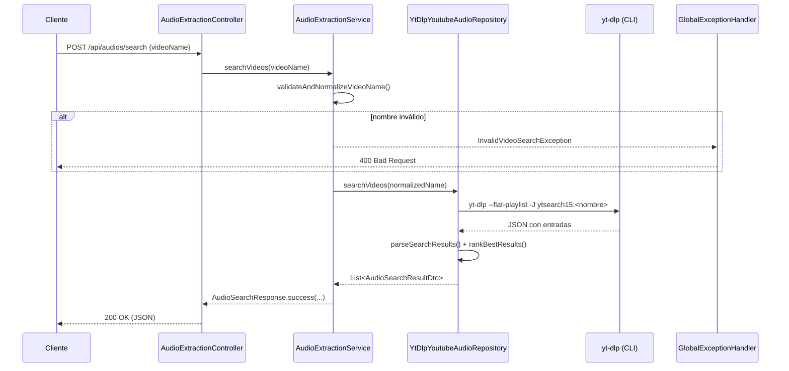
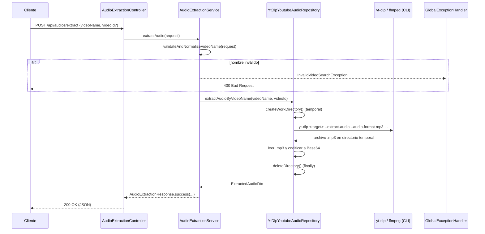

# Documentación de la API — YOUMP3API

API REST desarrollada con **Spring Boot** que permite buscar videos en YouTube y extraer su audio en formato MP3, utilizando `yt-dlp` y `ffmpeg` como herramientas externas del sistema.

- **Nombre de la aplicación:** `YOUMP3API`
- **Puerto:** `8088`
- **Base URL local:** `http://localhost:8088`
- **Java:** 17
- **Formato de intercambio:** JSON (`application/json`)

---

## Índice

1. [Arquitectura e interacción entre clases](#1-arquitectura-e-interacción-entre-clases)
2. [Endpoints](#2-endpoints)
3. [Manejo global de excepciones](#3-manejo-global-de-excepciones)
4. [Dependencias externas y requisitos](#4-dependencias-externas-y-requisitos)

---

## 1. Arquitectura e interacción entre clases

La aplicación sigue una arquitectura en capas clásica de Spring Boot: **Controller → Service → Repository**, con DTOs para la entrada/salida y excepciones de dominio que son traducidas a respuestas HTTP por un handler global.

```
Cliente HTTP
    │
    ▼
AudioExtractionController  (@RestController)
    │  deserializa el request y delega
    ▼
AudioExtractionService     (@Service)
    │  valida y normaliza "videoName"
    ▼
YoutubeAudioRepository     (interfaz)
    ▲
YtDlpYoutubeAudioRepository (@Repository)
    │  ejecuta procesos externos
    ▼
yt-dlp / ffmpeg (CLI) ──► YouTube
```

### Diagrama de secuencia — Búsqueda (`POST /api/audios/search`)



### Diagrama de secuencia — Extracción (`POST /api/audios/extract`)



### Detalle de clases

#### `AudioExtractionController` (`controller`)
`@RestController` acoplado a la ruta base `/api/audios`. Es la capa de entrada HTTP; **no contiene lógica de negocio**: solo deserializa el cuerpo JSON (`@RequestBody AudioExtractionRequest`) y delega en `AudioExtractionService`. Se inyecta el servicio vía **constructor**.

| Método | Ruta | Delega en | Respuesta |
|---|---|---|---|
| `searchVideos(@RequestBody)` | `POST /api/audios/search` | `service.searchVideos(request.getVideoName())` | `ResponseEntity<AudioSearchResponse>` (200 OK) |
| `extractAudio(@RequestBody)` | `POST /api/audios/extract` | `service.extractAudio(request)` | `ResponseEntity<AudioExtractionResponse>` (200 OK) |

#### `AudioExtractionService` (`service`)
`@Service` con la lógica de validación y orquestación. Depende del **interfaz** `YoutubeAudioRepository` (inversión de dependencias), lo que permite cambiar la implementación del repositorio sin afectar al servicio.

| Método | Responsabilidad |
|---|---|
| `searchVideos(String)` | Valida/normaliza el nombre, llama al repositorio y envuelve el resultado en `AudioSearchResponse.success("Resultados obtenidos.", results)`. |
| `extractAudio(AudioExtractionRequest)` | Valida/normaliza el nombre, llama al repositorio con `videoName` y `videoId`, y envuelve el resultado en `AudioExtractionResponse.success("Audio extraido correctamente.", audio)`. |
| `validateAndNormalizeVideoName(...)` (privado) | Lanza `InvalidVideoSearchException` si el nombre está vacío, tiene menos de 3 caracteres o más de 150. Retorna el nombre recortado (`trim()`). |

#### `YoutubeAudioRepository` (interfaz, `repository`)
Contrato de acceso a datos externos con dos operaciones:

```java
List<AudioSearchResultDto> searchVideos(String videoName);
ExtractedAudioDto extractAudioByVideoName(String videoName, String videoId);
```

#### `YtDlpYoutubeAudioRepository` (`repository`)
Única implementación (`@Repository`). Encapsula la ejecución de procesos externos de `yt-dlp` mediante `ProcessBuilder`, la lectura asíncrona de streams (stdout/stderr con `CompletableFuture`), timeouts, parsing de JSON con Jackson y limpieza de archivos temporales.

| Método | Qué hace |
|---|---|
| `searchVideos` | Ejecuta `yt-dlp --flat-playlist -J ytsearch15:<nombre>` (timeout 1 min), parsea las entradas JSON (`id`, `title`, `channel`/`uploader`, `duration`, `view_count`), descarta entradas sin id/título y rankea los resultados. Si no hay resultados lanza `InvalidVideoSearchException`. |
| `extractAudioByVideoName` | Crea un directorio temporal; construye el target: si hay `videoId` usa `https://www.youtube.com/watch?v=<id>`, si no usa `ytsearch1:<nombre>`. Ejecuta `yt-dlp --extract-audio --audio-format mp3 --audio-quality 0 --print title --no-simulate --no-playlist --extractor-args youtube:player_client=android` (timeout 3 min). Busca el `.mp3` generado, lo lee y lo codifica en Base64 dentro de `ExtractedAudioDto`. El directorio temporal se elimina siempre en `finally`. |
| `rankBestResults` (privado) | Deduplica por autor (el mejor por "quality score") y ordena descendente según `views + duration*1000`. |
| `resolveFriendlyError` (privado) | Traduce stderr de yt-dlp a mensajes amigables (ffmpeg ausente, 403/bloqueo, video privado, sin resultados). |

Errores que puede lanzar: `AudioExtractionException` (timeouts, fallo de proceso, sin audio), `YoutubeToolUnavailableException` (`IOException` al lanzar el proceso), `InvalidVideoSearchException` (búsqueda sin resultados).

#### DTOs (`dto`)

**Entrada**

| Clase | Campos | Uso |
|---|---|---|
| `AudioExtractionRequest` | `videoName` (String), `videoId` (String, opcional) | Cuerpo de ambos endpoints POST. |

**Intermedios de dominio**

| Clase | Campos | Uso |
|---|---|---|
| `AudioSearchResultDto` | `videoId`, `title`, `author`, `durationSeconds`, `viewCount` | Un resultado de búsqueda devuelto por el repositorio. |
| `ExtractedAudioDto` | `videoTitle`, `fileName`, `contentType`, `audioBase64` (inmutable) | Resultado de la extracción devuelto por el repositorio. |

**Salida HTTP**

| Clase | Campos | Fábricas estáticas |
|---|---|---|
| `AudioSearchResponse` | `success`, `message`, `results: List<AudioSearchResultDto>` | `success(message, results)` / `failure(message)` |
| `AudioExtractionResponse` | `success`, `message`, `videoTitle`, `fileName`, `contentType`, `audioBase64` | `success(message, ExtractedAudioDto)` / `failure(message)` |

> Nota: en errores, el handler global construye respuestas con `failure(message)`; el cliente debe mirar siempre el campo `success` además del código HTTP.

---

## 2. Endpoints

### 2.1 Buscar videos — `POST /api/audios/search`

Busca hasta 15 videos en YouTube y devuelve los resultados rankeados por relevancia/calidad.

**Request**

```
POST http://localhost:8088/api/audios/search
Content-Type: application/json
```

```json
{
  "videoName": "never gonna give you up"
}
```

| Campo | Tipo | Requerido | Reglas |
|---|---|---|---|
| `videoName` | string | Sí | 3–150 caracteres tras `trim()`. |

**Respuesta exitosa — `200 OK`**

```json
{
  "success": true,
  "message": "Resultados obtenidos.",
  "results": [
    {
      "videoId": "dQw4w9WgXcQ",
      "title": "Rick Astley - Never Gonna Give You Up",
      "author": "Rick Astley",
      "durationSeconds": 213,
      "viewCount": 1700000000
    }
  ]
}
```

**Ejemplo con curl**

```bash
curl -X POST http://localhost:8088/api/audios/search \
     -H "Content-Type: application/json" \
     -d '{"videoName": "never gonna give you up"}'
```

**Errores posibles:** `400`, `502`, `503` (ver sección 3).

---

### 2.2 Extraer audio — `POST /api/audios/extract`

Descarga el audio del video seleccionado y lo devuelve convertido a **MP3 codificado en Base64**.

**Request**

```
POST http://localhost:8088/api/audios/extract
Content-Type: application/json
```

```json
{
  "videoName": "never gonna give you up",
  "videoId": "dQw4w9WgXcQ"
}
```

| Campo | Tipo | Requerido | Reglas |
|---|---|---|---|
| `videoName` | string | Sí | 3–150 caracteres tras `trim()`. |
| `videoId` | string | No | Si se provee, se extrae directamente el video (`watch?v=<videoId>`). Si se omite, se extrae el **primer resultado** de la búsqueda por nombre (`ytsearch1:<videoName>`). |

**Respuesta exitosa — `200 OK`**

```json
{
  "success": true,
  "message": "Audio extraido correctamente.",
  "videoTitle": "Rick Astley - Never Gonna Give You Up (Official Music Video)",
  "fileName": "dQw4w9WgXcQ.mp3",
  "contentType": "audio/mpeg",
  "audioBase64": "<contenido binario del MP3 en Base64>"
}
```

| Campo | Descripción |
|---|---|
| `videoTitle` | Título impreso por yt-dlp (`--print title`); fallback al `videoName` enviado. |
| `fileName` | Nombre del archivo MP3 generado (`<videoId>.mp3`). |
| `contentType` | MIME detectado del archivo; por defecto `audio/mpeg`. |
| `audioBase64` | Bytes del MP3 codificados en Base64 estándar. |

**Ejemplo con curl (guardar el MP3 decodificado)**

```bash
curl -X POST http://localhost:8088/api/audios/extract \
     -H "Content-Type: application/json" \
     -d '{"videoName": "never gonna give you up", "videoId": "dQw4w9WgXcQ"}' \
  | python3 -c "import sys,json,base64; d=json.load(sys.stdin); open('audio.mp3','wb').write(base64.b64decode(d['audioBase64']))"
```

**Errores posibles:** `400`, `502`, `503`, `500` (ver sección 3).

---

## 3. Manejo global de excepciones

Todas las excepciones de la aplicación se capturan en **`GlobalExceptionHandler`** (paquete `exception`), anotado con `@RestControllerAdvice`, por lo que ningún endpoint lanza stacktraces al cliente: los errores siempre se devuelven como un `AudioExtractionResponse` con `success=false`.

### Jerarquía de excepciones

```
RuntimeException
├── AudioExtractionException          → 502 BAD_GATEWAY
├── YoutubeToolUnavailableException   → 503 SERVICE_UNAVAILABLE
└── InvalidVideoSearchException       → 400 BAD_REQUEST
(Exception genérica                   → 500 INTERNAL_SERVER_ERROR)
```

### Tabla de handlers

| Excepción manejada | Handler | Estado HTTP | Body (`AudioExtractionResponse.failure`) |
|---|---|---|---|
| `InvalidVideoSearchException` | `handleInvalidSearch` | `400 BAD_REQUEST` | Mensaje de la excepción (validación de `videoName` o búsqueda sin resultados). |
| `YoutubeToolUnavailableException` | `handleToolUnavailable` | `503 SERVICE_UNAVAILABLE` | `"The extraction service is unavailable. Check that yt-dlp and ffmpeg are installed."` |
| `AudioExtractionException` | `handleAudioExtraction` | `502 BAD_GATEWAY` | Mensaje de la excepción (timeout, fallo de yt-dlp, error de parsing, etc.). |
| `Exception` (cualquier otra) | `handleUnexpected` | `500 INTERNAL_SERVER_ERROR` | `"We could not process your request right now. Try again later."` (mensaje genérico; no se expone la causa interna). |

### Formato uniforme de error

```json
{
  "success": false,
  "message": "Enter the name of a video to search on YouTube.",
  "videoTitle": null,
  "fileName": null,
  "contentType": null,
  "audioBase64": null
}
```

### ¿Quién lanza cada excepción?

| Origen | Excepción | Condición |
|---|---|---|
| `AudioExtractionService.validateAndNormalizeVideoName` | `InvalidVideoSearchException` | `videoName` vacío, < 3 o > 150 caracteres. |
| `YtDlpYoutubeAudioRepository.searchVideos` | `AudioExtractionException` | Timeout de búsqueda (> 1 min), salida != 0 de yt-dlp, interrupción, JSON ilegible. |
| `YtDlpYoutubeAudioRepository.parseSearchResults` | `InvalidVideoSearchException` | La búsqueda no produjo ningún resultado válido. |
| `YtDlpYoutubeAudioRepository.extractAudioByVideoName` | `AudioExtractionException` | Timeout de extracción (> 3 min), salida != 0, no se encontró archivo `.mp3`, fallo creando el directorio temporal. |
| Cualquier `IOException` al lanzar el proceso | `YoutubeToolUnavailableException` | `yt-dlp`/`ffmpeg` no instalados o no accesibles. |

---

## 4. Dependencias externas y requisitos

- **yt-dlp** y **ffmpeg** deben estar instalados y disponibles en el `PATH` del servidor; sin ellos los endpoints responden `503`.
- Tiempo máximo de búsqueda: **1 minuto**. Tiempo máximo de extracción: **3 minutos**.
- Los archivos de audio se generan en un directorio temporal que **siempre se elimina** tras la extracción (bloque `finally`).
- La extracción usa el extractor arg `youtube:player_client=android` para mejorar la compatibilidad de acceso.

### Ejecución local

```bash
./mvnw spring-boot:run
# API disponible en http://localhost:8088/api/audios
```
